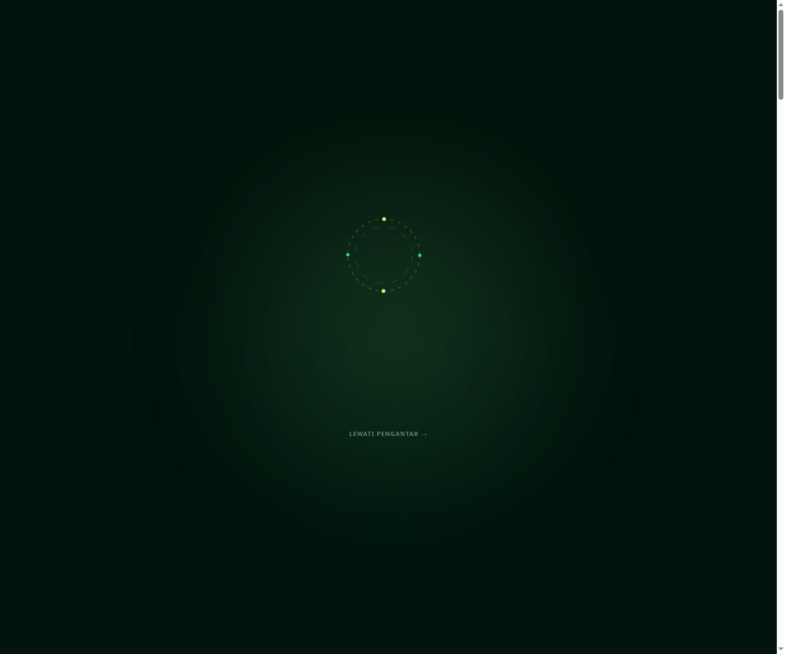
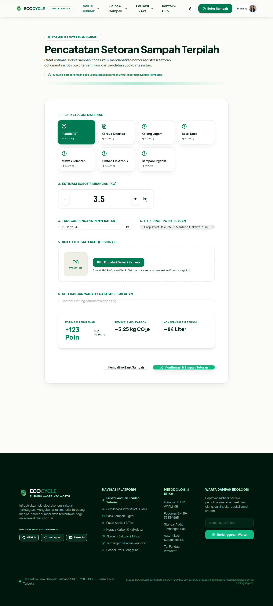
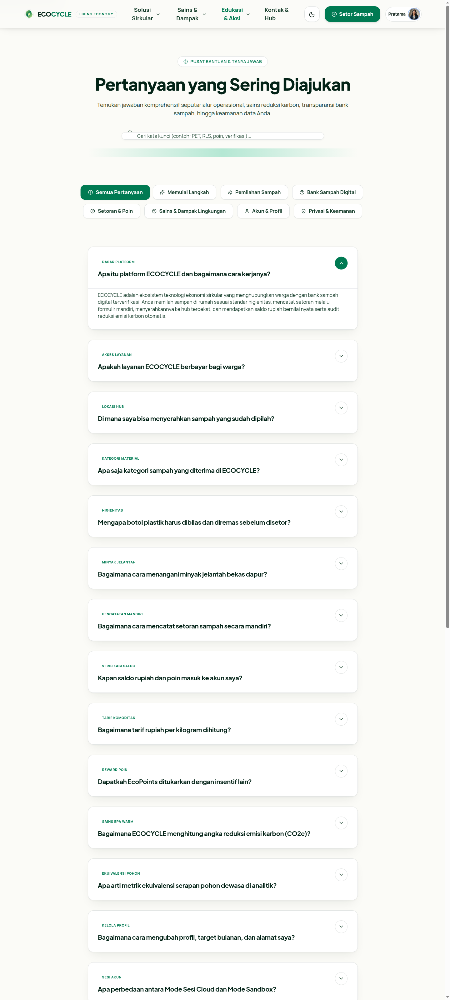
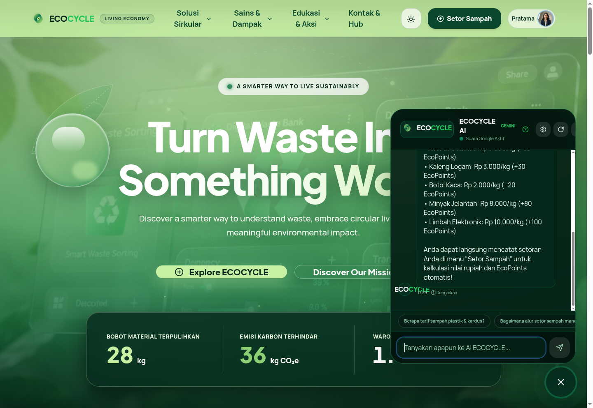
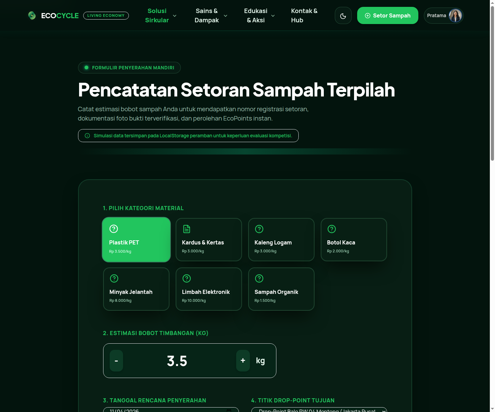

# ECOCYCLE — A Living Circular Economy Experience
### *Turning Waste Into Worth*

[](https://github.com/Maverick-list/ecocycle)
[](https://github.com/Maverick-list/ecocycle)
[](https://react.dev)
[](https://ai.google.dev)
[](https://github.com/Maverick-list/ecocycle)

> **Web Design Competition Techno Versary Vol. II 2026**  
> **Penyelenggara:** Himpunan Mahasiswa Teknik Informatika (HIMA TI), Fakultas Ilmu Komputer, Universitas Kuningan  
> **Tema:** *EcoDigital For Environment: Teknologi Digital sebagai Penggerak Kelestarian Bumi*  
> **Repository Resmi:** [github.com/Maverick-list/ecocycle](https://github.com/Maverick-list/ecocycle)  

---

## 📸 Galeri Tangkapan Layar Platform (Visual Showcase)

Berikut adalah dokumentasi visual antarmuka platform ECOCYCLE yang telah menerapkan *Apple-level visual identity*, sistem kaca visionOS, serta animasi organik tingkat lanjut:

| 1. Beranda Hero dengan Videotron Transparan 30% | 2. Formulir Setor Sampah Mandiri (Spacious & Clean) |
| :---: | :---: |
|  |  |

| 3. Pusat Jawaban FAQ dengan Akordeon Lapang | 4. ECOCYCLE AI Chatbot (Google Voice TTS & VisionOS Glass) |
| :---: | :---: |
|  |  |

| 5. Mode Gelap Obsidian Hijau Botani Terverifikasi |
| :---: |
|  |

---

## 🎯 Case & Solusi (Studi Kasus Lingkungan)

### 1. Masalah Lingkungan Riil (*The Problem Case*)
Pengelolaan sampah di Indonesia, khususnya di kawasan permukiman perkotaan dan lingkungan kampus di wilayah Jawa Barat, menghadapi empat tantangan kritis:
1. **Kegagalan Pemilahan di Tingkat Rumah Tangga:** Lebih dari **69% timbunan sampah berakhir langsung di TPA (Tempat Pemrosesan Akhir)** dalam kondisi tercampur, busuk, dan terkontaminasi. Material anorganik bernilai daur ulang tinggi (seperti botol PET dan kardus) kehilangan nilai ekonominya hingga 80% karena kotoran sisa makanan dan minyak.
2. **Ketiadaan Transparansi & Insentif Ekonomi Langsung:** Warga sering kali memandang memilah sampah sebagai beban tanpa imbalan yang jelas. Bank sampah konvensional masih menggunakan buku tulis fisik, rentan manipulasi timbangan, dan lambat dalam pencairan dana.
3. **Dampak Ekologis yang "Tak Kasat Mata":** Masyarakat tidak mengetahui berapa emisi karbon (CO₂e) yang berhasil mereka cegah atau berapa liter air bersih yang berhasil diselamatkan dari kebiasaan memilah yang mereka lakukan.
4. **Hambatan Literasi & Akses Informasi:** Masih banyak mitos seputar daur ulang (misal: "semua sampah di truk sampah akan digabung lagi"), serta minimnya edukasi interaktif yang menyenangkan bagi generasi muda.

### 2. Solusi Holistik ECOCYCLE (*The EcoDigital Solution*)
**ECOCYCLE** mentransformasi tata kelola sampah menjadi **ekosistem ekonomi sirkular digital** berbasis teknologi web modern:
- **Digitalisasi Bank Sampah Mandiri (SNI 19-3983-1995):** Menghubungkan warga ke hub bank sampah terverifikasi melalui pencatatan setoran digital, penerbitan kode manifest terenkripsi, dan dokumentasi foto bukti fisik.
- **Dual-Ledger: Insentif Finansial + Kredit Ekologis:** Setiap kilogram sampah yang disetor tidak hanya menghasilkan **saldo Rupiah**, tetapi juga mengkreditkan **EcoPoints** yang dapat ditukarkan dengan insentif hijau (bibit tanaman produktif, kupon sembako ramah lingkungan, diskon transportasi bersih).
- **Audit Karbon Saintifik (US EPA WARM v15):** Menerapkan model reduksi emisi global yang menghitung konversi pasti reduksi gas rumah kaca (kg CO₂e), ekuivalensi pohon dewasa, dan konservasi air bersih secara *real-time*.
- **ECOCYCLE AI Assistant dengan Suara Google:** Menghadirkan asisten kecerdasan buatan berbasis Google Gemini dan Google Speech Synthesis bahasa Indonesia agar setiap lapisan masyarakat dapat berkonsultasi secara audio-visual 24/7.

---

## ✨ Apa yang Menarik dan Paling Unik? (Diferensiasi Platform)

Mengapa ECOCYCLE berbeda dan jauh mengungguli website bertema lingkungan atau template bank sampah biasa?

### 1. 🤖 Asisten AI Gemini dengan Sintesis Suara Google (Google Indonesian Voice TTS)
Bukan sekadar *widget chat* teks biasa. Chatbot ECOCYCLE terintegrasi dengan kecerdasan buatan Google Gemini dan dilengkapi Web Speech API dengan pendeteksian otomatis **Suara Google Bahasa Indonesia**. Saat teks penjelasan berjalan, AI berbicara secara simultan dengan gelombang audio (*equalizer*) interaktif, tombol dengarkan ulang, serta pengaturan kunci API opsional.

### 2. 🎬 Latar Belakang Hero Videotron Bergerak Transparan 30%
Pada bagian pembuka beranda (*hero section*), ECOCYCLE menyematkan video gerak 3D sirkular ekologis dengan tingkat transparansi tepat **30% (`opacity-30`)**. Berfungsi sebagai videotron bergerak di balik tulisan teks headline dan metrik data, menciptakan impresi estetika teknologi tingkat tinggi tanpa mengorbankan keterbacaan teks (*editorial typography*).

### 3. 🍃 Transisi Halaman Daun Organik Mulus (*Smooth Organic Leaf Transition*)
Setiap kali pengguna berpindah rute di dalam aplikasi, tirai hijau botani menyapu layar disertai **siluet daun-daun bergradasi hijau zamrud dan lime yang berotasi secara organik**. Pengalaman navigasi terasa hidup, menyegarkan, dan memanjakan indera visual.

### 4. 🌀 Layar Pembuka Pengunjung Baru (*First-Visit Atmospheric Intro*)
Saat pengunjung pertama kali mengakses website, sistem menampilkan adegan pembuka eksklusif: orbit daur ulang berputar dinamis, mekarnya dua helai daun geometris, pengungkapan logo ECOCYCLE, dan indikator inisialisasi sirkular sebelum masuk secara mulus ke halaman utama.

### 5. 💎 Bahasa Desain Apple visionOS Tanpa Garis Kaku
Seluruh antarmuka menggunakan kaca transparan bertingkat (*frosted glassmorphism*), pencahayaan radial alami, dan **pembatas gradasi lembut pudar** menggantikan garis lurus kaku antara navigasi, badan konten, dan footer.

### 6. 🔬 Sains Emisi Karbon Terverifikasi (Bukan Estimasi Acak)
Menggunakan metodologi saintifik terakreditasi *US EPA WARM (Waste Reduction Model) v15*:
- 1 kg Plastik PET = Mereduksi ~1.50 kg CO₂e
- 1 kg Kaleng Logam = Mereduksi ~3.20 kg CO₂e
- 1 kg Kardus = Mereduksi ~1.05 kg CO₂e
- 1 kg Minyak Jelantah = Mereduksi ~2.60 kg CO₂e

---

## 📖 Panduan Penggunaan Platform (Step-by-Step User Guide)

### Langkah 1: Membuka Website & Berkonsultasi dengan ECOCYCLE AI
1. Kunjungi platform ECOCYCLE. Nikmati animasi intro pembuka dan hero videotron transparan 30%.
2. Klik tombol mengambang bundar berlogo ECOCYCLE di pojok kanan bawah (**Tanya AI ECOCYCLE**).
3. Pilih salah satu *chip* pertanyaan siap pakai (contoh: *"Berapa tarif sampah plastik & kardus?"*) atau ketik pertanyaan apa pun.
4. AI akan menjawab secara terstruktur sembari **berbicara langsung dalam Bahasa Indonesia**. Gunakan tombol speaker untuk mendengarkan ulang atau tombol bisu jika ingin membaca saja.

### Langkah 2: Mengidentifikasi & Memilah Sampah dari Rumah
1. Klik menu **Solusi Sirkular > Pemilahan Pintar (Sort Guide)**.
2. Cari material yang Anda miliki (Plastik PET, Kertas/Kardus, Logam, Kaca, Minyak Jelantah, E-Waste).
3. Ikuti protokol dekontaminasi: bilas sisa cairan/gula, keringkan, dan pipihkan untuk efisiensi logistik hingga 70%.

### Langkah 3: Mencatat Setoran Sampah Mandiri
1. Klik tombol hijau **Setor Sampah** di pojok kanan atas atau buka rute `/setor-sampah`.
2. **Pilih Kategori:** Klik salah satu material (misal: Plastik PET Rp3.500/kg).
3. **Tentukan Bobot:** Atur tombol stepper timbangan (misal: 3.5 kg).
4. **Pilih Tanggal & Hub:** Pilih tanggal rencana serah dan titik *Drop-Point* terdekat (contoh: *Bale RW 04 Menteng* atau *Gedung Serbaguna Kuningan*).
5. **Unggah Bukti (Opsional):** Pilih foto dari galeri kamera untuk validasi manifest.
6. **Periksa Konversi:** Tinjau estimasi Rupiah, perolehan EcoPoints, reduksi emisi karbon (kg CO₂e), dan konservasi air bersih.
7. Tekan **Konfirmasi & Simpan Setoran**.

### Langkah 4: Memantau Buku Tabungan Digital
1. Buka menu **Solusi Sirkular > Bank Sampah Digital**.
2. Periksa saldo aktif Rupiah dan tabungan EcoPoints Anda.
3. Lihat riwayat mutasi transaksi yang tersusun rapi dengan nomor manifest, stempel waktu, dan lencana verifikasi.
4. Anda dapat mensimulasikan penarikan saldo atau penukaran poin menjadi voucher belanja ramah lingkungan.

### Langkah 5: Mengaudit Dampak Lingkungan & Sains Reduksi Karbon
1. Kunjungi menu **Sains & Dampak > Neraca Karbon & Kalkulator**.
2. Gunakan kalkulator simulasi interaktif untuk melihat seberapa besar kontribusi Anda terhadap pencegahan gas rumah kaca dan penyelamatan pohon tahunan.
3. Masuk ke **Pusat Analitik** untuk melihat grafik komparatif fraksi material (*Recharts*) serta mengunduh dataset resmi format CSV/JSON.

### Langkah 6: Mengikuti Tantangan Komunitas & Meraih Lencana
1. Kunjungi menu **Edukasi & Aksi > Tantangan Komunitas**.
2. Bergabung dalam tantangan aktif (misal: *"Gerakan 1 Minggu Bebas Plastik Sekali Pakai"*).
3. Kumpulkan lencana reputasi dan pantau posisi Anda di papan peringkat (*Leaderboard*) masyarakat se-Kuningan.

### Langkah 7: Beralih Antara Mode Terang & Mode Gelap
- Klik tombol ikon matahari/bulan di navigasi atas.
- Mode terang menghadirkan kesegaran kanvas botani yang jernih, sedangkan mode gelap menghadirkan keanggunan *deep emerald obsidian* (`#03140d`) dengan kontras tinggi yang nyaman di mata.

---

## 🛠️ Arsitektur Teknologi & Dependensi

Platform ECOCYCLE dibangun dengan arsitektur rekayasa perangkat lunak modern:

| Komponen | Teknologi | Keterangan |
|---|---|---|
| **Core Framework** | React 19.3 + TypeScript 7.0 | UI reaktif berbasis komponen modular dan *type-safety* ketat |
| **Build Tooling** | Vite 8.3 + PostCSS | Kompilasi ultra-cepat, HMR instan, dan *code splitting* |
| **Styling & Design System** | Tailwind CSS 3.4 | Variabel CSS kustom, glassmorphism visionOS, dan transisi gradien halus |
| **Motion Engine** | Framer Motion 14.9 | Animasi rute (*LeafPageTransition*), *presence exit/enter*, dan *gesture physics* |
| **Artificial Intelligence** | Google Gemini API (Flash Models) | Inferensi bahasa alami dengan panduan sistem domain lingkungan |
| **Speech Engine** | Web Speech API (Google Indonesian Voice) | Sintesis audio percakapan natural berbahasa Indonesia |
| **Data Visualizations** | Recharts 3.10 | Grafik area dinamis dan visualisasi alur material temporal |
| **Cloud Backend** | Google Firebase + Supabase (Dual-Engine) | Firebase Auth & Firestore + Supabase Row Level Security (RLS) |
| **Icons & Assets** | Google Material Symbols & Lucide React | Ikonografi modern konsisten dengan semantik aksibilitas |

---

## 💻 Panduan Menjalankan Proyek Secara Lokal

Pastikan Anda telah menginstal **Node.js (versi 18+)** dan **npm**:

```bash
# 1. Kloning repository GitHub
git clone https://github.com/Maverick-list/ecocycle.git

# 2. Masuk ke direktori proyek
cd ecocycle

# 3. Instal dependensi paket
npm install

# 4. Salin file template lingkungan (opsional untuk integrasi cloud penuh)
cp .env.example .env

# 5. Jalankan server pengembangan lokal (Vite)
npm run dev
```

Buka peramban Anda dan akses URL: **`http://localhost:3000`**

### Perintah Pengujian & Kompilasi Produksi:
```bash
# Pemeriksaan tipe data TypeScript
npx tsc --noEmit

# Kompilasi build produksi dan prerender statis 10 rute
npm run build

# Menjalankan preview build produksi
npm run preview
```

---

## 👥 Pengembang & Hak Cipta

Proyek ini dirancang dan dikembangkan dengan standar tertinggi oleh:
- **Pengembang & Arsitek Proyek:** Tim Pengembang ECOCYCLE
- **Afiliasi:** Universitas Kuningan, Jawa Barat
- **Hak Cipta:** © 2026 ECOCYCLE Foundation. *Seluruh hak cipta dilindungi undang-undang. Mengubah aliran material menjadi neraca sumber daya terverifikasi dan bernilai nyata.*
