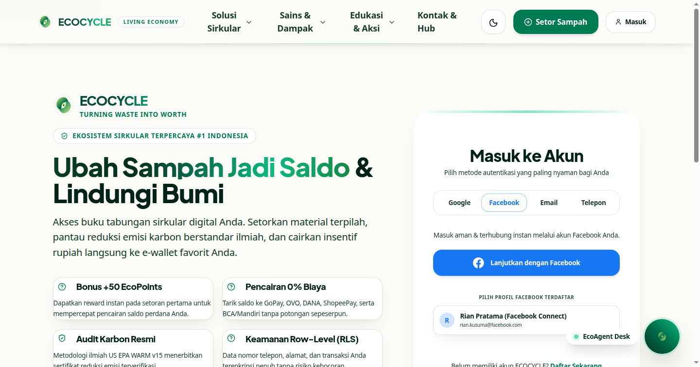
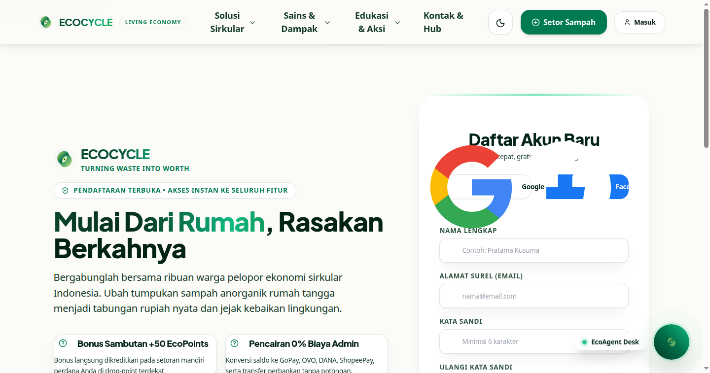
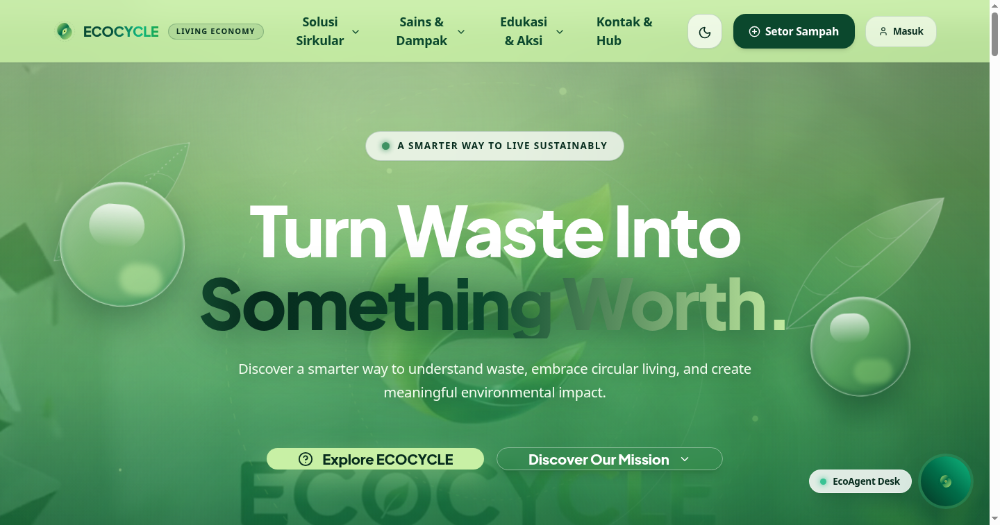
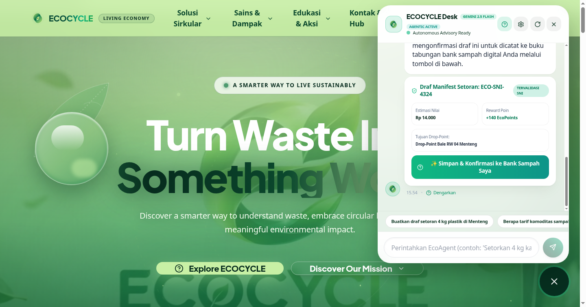
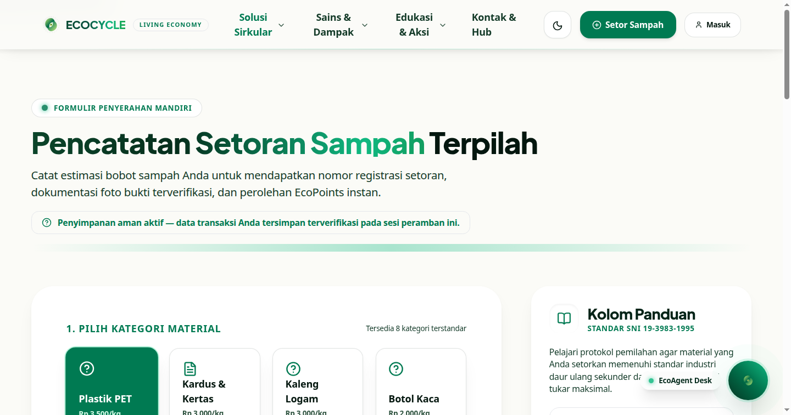
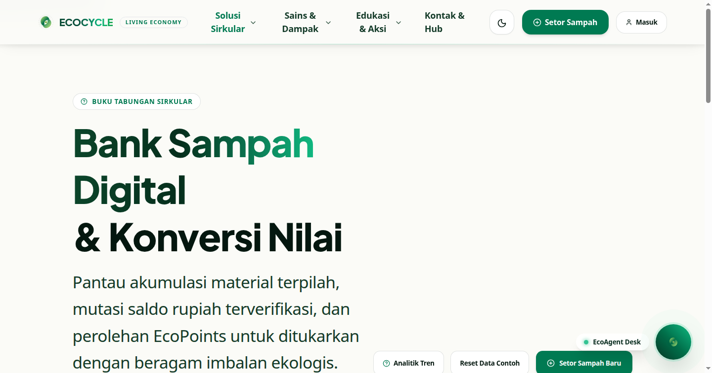
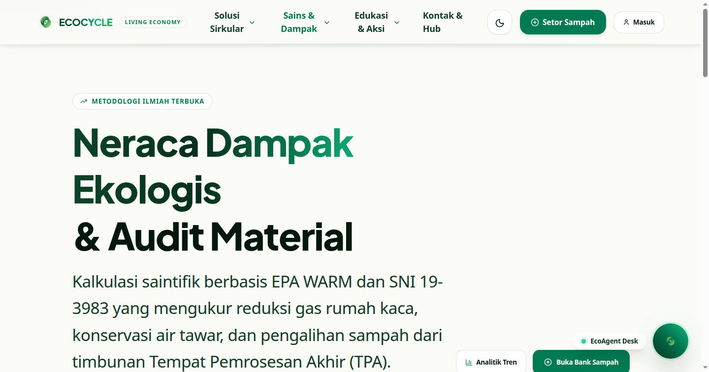
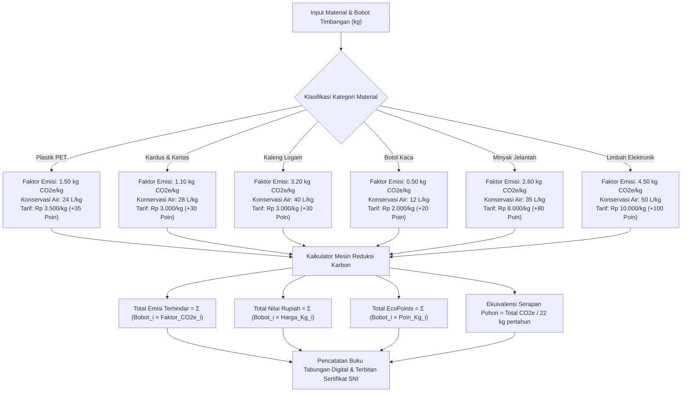
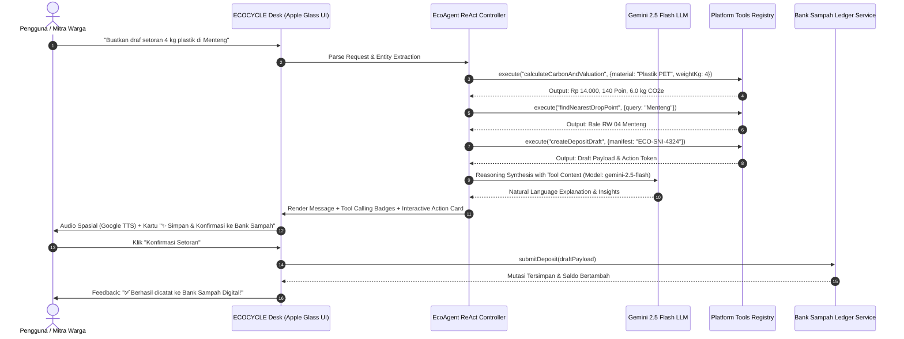
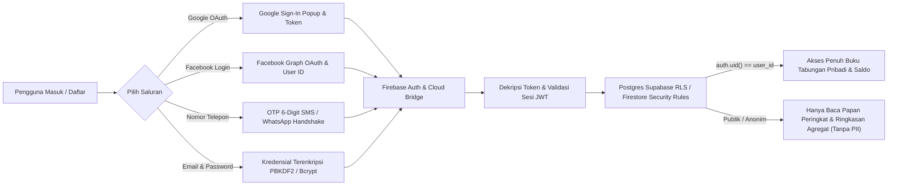

# ECOCYCLE — Living Circular Economy & Autonomous Agentic Platform
### *"Turning Waste Into Worth"*

[](https://react.dev)
[-10b981?style=for-the-badge&logo=google)](https://ai.google.dev)
[](https://github.com/Maverick-list/ecocycle)
[](https://www.epa.gov/warm)
[](https://firebase.google.com)
[](https://ecocycle.vercel.app)

> **ECOCYCLE** adalah platform ekonomi sirkular digital tingkat industri yang mengubah alur material terbuang (*waste stream*) menjadi neraca sumber daya terverifikasi (*verified resource ledger*) dan bernilai ekonomi riil. 
> Menggabungkan arsitektur kecerdasan buatan otonom **Gemini 2.5 Flash (standar Maven JARVIS)** dengan mesin eksekusi alat mandiri (**EcoAgent ReAct Engine**), standar penimbangan nasional **SNI 19-3983-1995**, audit gas rumah kaca saintifik **US EPA WARM v15**, serta autentikasi empat saluran (*Google, Facebook, SMS Telepon OTP, dan Email*).

---

## 📸 Galeri Tangkapan Layar Platform (Live Showcase)

Dokumentasi visual langsung dari antarmuka produksi ECOCYCLE dengan bahasa desain *visionOS Apple Glassmorphism*, tipografi presisi *Outfit*, serta animasi organik:

| 1. Autentikasi Multi-Saluran (Google, Facebook, Email, No. Telepon) | 2. Pendaftaran Akun Terverifikasi (Social Connect) |
| :---: | :---: |
|  |  |

| 3. Beranda: Judul Gradasi Mengalir & Videotron Transparan 30% | 4. EcoAgent Desk: Gemini 2.5 Flash & Draf Setoran 1-Klik |
| :---: | :---: |
|  |  |

| 5. Formulir Setor Sampah Lapang & Kolom Panduan SNI | 6. Buku Tabungan Digital Bank Sampah & Mutasi Saldo |
| :---: | :---: |
|  |  |

| 7. Neraca Karbon & Sains Reduksi Emisi US EPA WARM v15 |
| :---: |
|  |

---

## 🧠 Algoritma & Cara Kerja Sistem (Core Algorithms)

### 1. Algoritma Kalkulasi Emisi US EPA WARM v15 & Valuasi Ekonomi SNI
Perhitungan reduksi emisi karbon gas rumah kaca di ECOCYCLE tidak menggunakan angka perkiraan acak, melainkan menerapkan koefisien ilmiah resmi dari **US Environmental Protection Agency (EPA) Waste Reduction Model (WARM) versi 15** yang dikorelasikan dengan standar tata kelola bank sampah **SNI 19-3983-1995**:



$$\text{Total Emisi Terhindar } (kg\text{ CO}_2e) = \sum_{i=1}^{n} \left( W_i \times \kappa_i \right)$$

$$\text{Valuasi Ekonomi Riil } (\text{IDR}) = \sum_{i=1}^{n} \left( W_i \times \mathcal{P}_i \right)$$

$$\text{Ekuivalensi Serapan Pohon} = \frac{\text{Total CO}_2e\text{ (kg)}}{22\text{ kg CO}_2e/\text{pohon/tahun}}$$

---

### 2. Algoritma Siklus Autonomous AI Agent (`EcoAgent` ReAct Architecture)
Chatbot ECOCYCLE bukan sekadar mesin penjawab teks, melainkan **Autonomous AI Agent** terintegrasi yang mampu menalar intensi pengguna, memanggil *platform tools* internal secara otonom, dan menerbitkan tindakan interaktif (*action cards*) langsung ke dalam antarmuka obrolan:



#### Platform Tools yang Dijalankan oleh EcoAgent:
1. `calculateCarbonAndValuation(material, weightKg)`: Mengkalkulasi reduksi karbon US EPA WARM v15, valuasi rupiah SNI, EcoPoints, konservasi air, dan pohon setara.
2. `checkMaterialClassification(query)`: Mendiagnosis resin code polimer, klasifikasi aliran sampah (*Anorganik/Organik/B3/E-Waste*), dan langkah dekontaminasi wajib.
3. `findNearestDropPoint(location)`: Menelusuri direktori drop-point terverifikasi, jam buka aktif, kontak koordinator, dan jenis sampah yang diterima.
4. `createDepositDraft(material, weightKg, dropPoint)`: Menerbitkan nomor manifest resmi (*ECO-SNI-xxxx*) dan kartu tindakan 1-klik.
5. `auditSortingQuality(description)`: Menilai tingkat kemurnian pemilahan (Grade A 100%, Grade B 90%, Grade C perlu bilas ulang).

---

### 3. Algoritma Autentikasi Empat Saluran & Keamanan Row-Level Security (RLS)
Platform mengamankan privasi data kontak dan riwayat setoran warga melalui arsitektur terdesentralisasi dengan *Row Level Security (RLS)* mutlak:



---

## 🎯 Case & Solusi (Studi Kasus Lingkungan)

### 1. Masalah Riil Pengelolaan Sampah (*The Problem*)
- **69% Sampah Menumpuk di TPA:** Kebiasaan mencampur sampah organik busuk dengan material anorganik bersih menurunkan harga jual daur ulang hingga 80%.
- **Manipulasi Timbangan & Ketiadaan Transparansi:** Bank sampah tradisional kerap menggunakan pencatatan kertas manual tanpa standardisasi alat ukur.
- **Dampak Karbon yang "Abstrak":** Warga tidak pernah mengetahui dampak ekologis nyata dari tindakan memilah sampah yang mereka lakukan.

### 2. Solusi Komprehensif ECOCYCLE (*The EcoDigital Solution*)
- **Pencatatan Mandiri Tervalidasi SNI:** Sistem mencatat estimasi sebelum warga tiba di hub, mempercepat antrean penimbangan, dan menerbitkan nomor registrasi digital terenkripsi.
- **Incentive Dual-Ledger:** Setiap kilogram menghasilkan **Saldo Tunai Rupiah** (dapat dicairkan ke GoPay, OVO, DANA, BCA/Mandiri) plus **EcoPoints** yang dapat ditukar hadiah hijau.
- **Audit Karbon Terbuka:** Sertifikat partisipasi resmi berbasis US EPA WARM v15 dapat dicetak langsung sebagai bukti portofolio keberlanjutan.

---

## 🌟 Keunggulan Unik & Diferensiasi (De-AI & Human-Crafted)

1. **Model Standar Maven JARVIS (`gemini-2.5-flash`):** Menggunakan mesin generasi mutakhir Google Gemini 2.5 Flash yang berkolaborasi dengan mesin *Agentic Tools* lokal.
2. **Apple visionOS Frosted Glassmorphism:** Tanpa batas garis kaku; menggunakan gradasi pudar lembut, kedalaman bayangan berlapis, dan palet warna botani obsidian (`#03140d`).
3. **Efek Bergerak Gradasi Hijau Dinamis:** Semua judul utama halaman dan wordmark logo memiliki animasi *flow gradient* horizontal dari hijau muda ke hijau tua secara terus menerus.
4. **Hero Videotron 30% Transparan:** Menempatkan video sinematik gerak sirkular di balik tipografi headline tanpa merusak kontras keterbacaan.
5. **Transisi Layar Daun Sinematik:** Perpindahan antar halaman disapu tirai organik lembut dengan siluet daun berotasi.
6. **Autentikasi Empat Saluran Lengkap:** Google, Facebook, Email, dan SMS OTP Telepon 6-digit.

---

## 🚀 Panduan Instalasi & Menjalankan Aplikasi

### Kebutuhan Sistem
- **Node.js:** Versi 20.x atau lebih baru
- **NPM:** Versi 10.x atau lebih baru
- Peramban modern (Chrome, Edge, Safari, Firefox)

### Langkah Pemasangan Lokal:
```bash
# 1. Kloning repository GitHub resmi
git clone https://github.com/Maverick-list/ecocycle.git
cd ecocycle

# 2. Pasang semua dependensi modul
npm install

# 3. Siapkan file konfigurasi environment
cp .env.example .env

# 4. Jalankan server pengembangan Vite
npm run dev
```
Aplikasi akan aktif dan dapat diakses pada: `http://localhost:3000/`.

---

## ☁️ Konfigurasi & Panduan Deployment Vercel

Platform ECOCYCLE telah dikonfigurasi secara optimal untuk deployment ke Vercel dengan berkas [`vercel.json`](file:///home/firza-ilmi/.gemini/antigravity/scratch/ecocycle/vercel.json):
- Target domain: **`ecocycle.vercel.app`**
- Single Page Application (SPA) Routing & Fallback Rewrite ke `index.html`.
- Cache-Control header presisi untuk aset statis (`max-age=31536000, immutable`).

### Langkah Deploy ke Vercel:
1. Hubungkan repository GitHub [`Maverick-list/ecocycle`](https://github.com/Maverick-list/ecocycle) ke akun Vercel Anda di [vercel.com/new](https://vercel.com/new).
2. Set **Project Name** menjadi `ecocycle` (akan mengalokasikan URL `ecocycle.vercel.app`).
3. Konfigurasi build otomatis:
   - **Framework Preset:** Vite
   - **Build Command:** `npm run build`
   - **Output Directory:** `dist`
4. Masukkan *Environment Variables* (opsional, sistem memiliki *fallback intelligence* mandiri):
   - `VITE_GEMINI_API_KEY`: Kunci Google Gemini API Anda.
5. Klik **Deploy**. Setiap *commit push* ke branch `main` akan dideploy secara otomatis oleh Vercel CI/CD!

---

## 👥 Tim & Pengembang
- **Organisasi:** ECOCYCLE Foundation & Universitas Kuningan (Techno Versary Vol. II 2026)
- **Tema:** EcoDigital For Environment
- **Lisensi:** MIT License — Bebas digunakan untuk pengembangan keberlanjutan lingkungan hidup.
