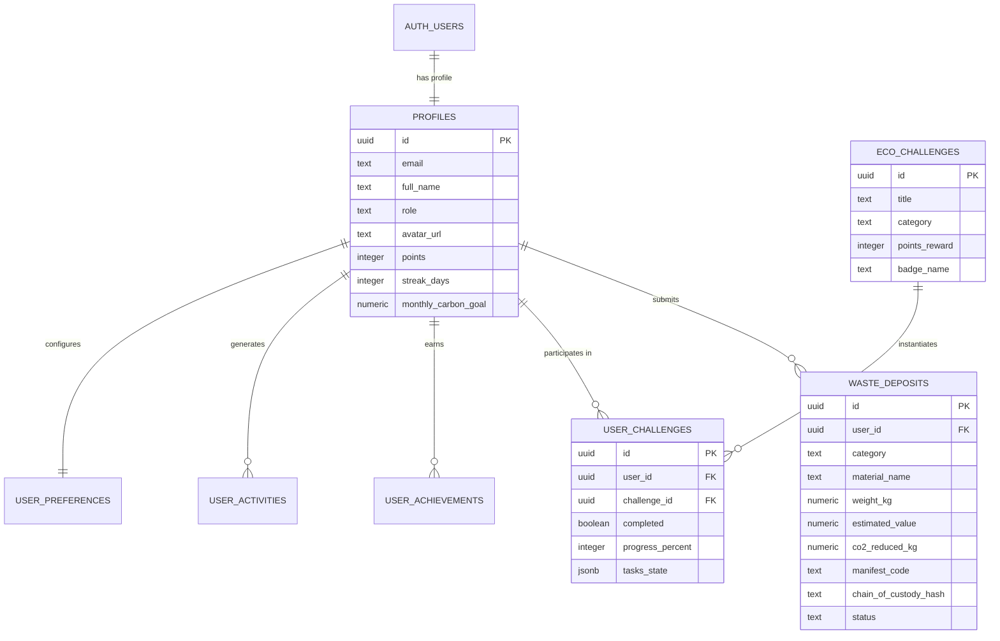

# ECOCYCLE — DATABASE SCHEMA & DATA DICTIONARY
**Dokumen Skema Basis Data Relasional & Kebijakan Row Level Security (RLS)**  
**Versi:** 2.5.0 Production Enterprise  
**Target RDBMS:** PostgreSQL 15+ / Supabase Cloud  
**Berkas Migrasi SQL:** [`supabase/migrations/20261104_ecocycle_schema.sql`](file:///home/firza-ilmi/.gemini/antigravity/scratch/ecocycle/supabase/migrations/20261104_ecocycle_schema.sql)  

---

## 1. DIAGRAM RELASI ENTITAS (ENTITY RELATIONSHIP DIAGRAM)



---

## 2. SPESIFIKASI TABEL & KAMUS DATA (DATA DICTIONARY)

### 2.1 Tabel `public.profiles`
Menyimpan data identitas, reputasi sirkular, dan saldo EcoPoints pengguna:
| Kolom | Tipe Data | Constraint | Keterangan |
| :--- | :--- | :--- | :--- |
| `id` | `UUID` | `PK, REFERENCES auth.users(id)` | ID unik pengguna dari Supabase Auth |
| `email` | `TEXT` | `NOT NULL` | Alamat surel aktif |
| `full_name` | `TEXT` | `NOT NULL` | Nama lengkap pengguna |
| `role` | `TEXT` | `DEFAULT 'Warga Sirkular'` | Peran / strata pengguna di komunitas |
| `avatar_url` | `TEXT` | `NULLABLE` | URL foto profil |
| `points` | `INTEGER` | `DEFAULT 0` | Akumulasi saldo poin penghargaan sirkular |
| `streak_days` | `INTEGER` | `DEFAULT 1` | Hari berturut-turut melakukan pemilahan sampah |
| `monthly_carbon_goal` | `NUMERIC(10,2)` | `DEFAULT 15.00` | Target reduksi emisi bulanan ($kg\ CO_2e$) |
| `created_at` | `TIMESTAMPTZ`| `DEFAULT NOW()` | Waktu pembuatan akun |

### 2.2 Tabel `public.waste_deposits`
Menyimpan catatan transaksi setoran sampah dan audit dampak lingkungan:
| Kolom | Tipe Data | Constraint | Keterangan |
| :--- | :--- | :--- | :--- |
| `id` | `UUID` | `PK, DEFAULT uuid_generate_v4()`| ID transaksi setoran |
| `user_id` | `UUID` | `FK, REFERENCES public.profiles(id)`| Pemilik transaksi (penyetor) |
| `category` | `TEXT` | `NOT NULL` | Kategori (Plastik, Kertas, Logam, dsb.) |
| `material_name` | `TEXT` | `NOT NULL` | Spesifikasi material (PET, Kardus, Jelantah) |
| `stream` | `TEXT` | `DEFAULT 'Anorganik'` | Jalur aliran sampah |
| `weight_kg` | `NUMERIC(10,2)` | `CHECK (weight_kg > 0)` | Berat terverifikasi timbangan (kg) |
| `estimated_value` | `NUMERIC(12,2)` | `NOT NULL` | Nilai estimasi konversi rupiah |
| `co2_reduced_kg` | `NUMERIC(10,2)` | `DEFAULT 0` | Emisi $CO_2e$ yang berhasil dicegah |
| `water_saved_liters` | `NUMERIC(10,2)` | `DEFAULT 0` | Air bersih yang terkonservasi |
| `manifest_code` | `TEXT` | `UNIQUE, NOT NULL` | Nomor manifest pelacakan unik |
| `chain_of_custody_hash`| `TEXT` | `NOT NULL` | Hash verifikasi rantai lacak |
| `status` | `TEXT` | `CHECK (status IN (...))` | Status (Diajukan, Diterima, Terverifikasi) |

---

## 3. ATURAN ROW LEVEL SECURITY (RLS)

Seluruh tabel dilindungi dengan kebijakan RLS mutlak:
- **`profiles`:** Pengguna hanya dapat memodifikasi baris miliknya sendiri (`auth.uid() = id`). Data leaderboard publik dibatasi pada nama dan akumulasi poin.
- **`waste_deposits`:** Pengguna hanya diizinkan membaca (`SELECT`), menambahkan (`INSERT`), atau memperbarui (`UPDATE`) transaksi miliknya (`auth.uid() = user_id`).
- **`user_challenges` & `user_achievements`:** Terkunci secara privat bagi masing-masing `user_id`.

---

## 4. AUTOMATED POSTGRESQL TRIGGER

Trigger otomatis dibuat untuk memastikan pembuatan profil instan ketika pengguna melakukan Sign Up:

```sql
CREATE OR REPLACE FUNCTION public.handle_new_user()
RETURNS TRIGGER AS $$
BEGIN
  INSERT INTO public.profiles (id, email, full_name, avatar_url)
  VALUES (
    NEW.id,
    NEW.email,
    COALESCE(NEW.raw_user_meta_data->>'full_name', 'Pegiat Sirkular'),
    COALESCE(NEW.raw_user_meta_data->>'avatar_url', '')
  );

  INSERT INTO public.user_preferences (user_id)
  VALUES (NEW.id);

  RETURN NEW;
END;
$$ LANGUAGE plpgsql SECURITY DEFINER;
```
