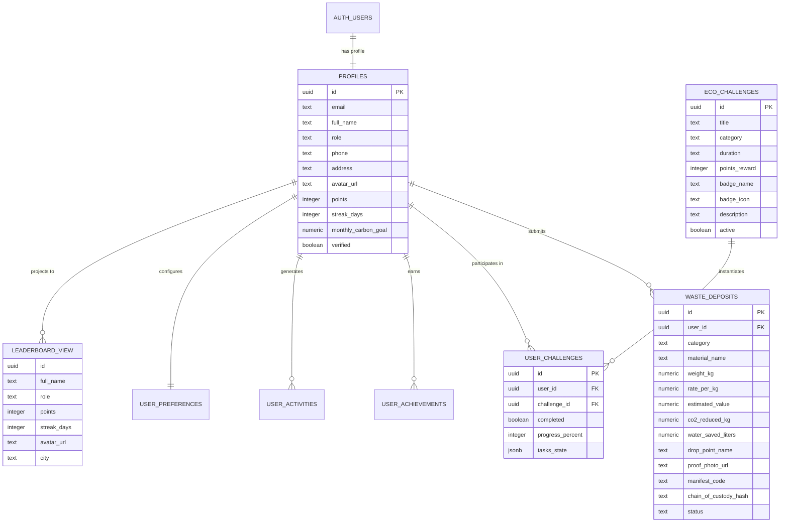

# ECOCYCLE — DATABASE SCHEMA & DATA DICTIONARY
**Dokumen Skema Basis Data Relasional & Kebijakan Row Level Security (RLS)**  
**Versi:** 2.6.0 Production Release Documentation  
**Target RDBMS:** PostgreSQL 15+ / Supabase Cloud  
**Berkas Migrasi SQL:** [`supabase/migrations/20261104_ecocycle_schema.sql`](file:///home/firza-ilmi/.gemini/antigravity/scratch/ecocycle/supabase/migrations/20261104_ecocycle_schema.sql)  

---

## 1. DIAGRAM RELASI ENTITAS (ENTITY RELATIONSHIP DIAGRAM)

---

## 2. KAMUS DATA UTAMA (DATA DICTIONARY)

### 2.1 Tabel `public.profiles`
| Nama Kolom | Tipe Data | Keterangan & Aturan |
| :--- | :--- | :--- |
| `id` | `UUID PRIMARY KEY` | Merujuk langsung ke `auth.users(id)` dengan `ON DELETE CASCADE`. |
| `email` | `TEXT NOT NULL` | Alamat surel terdaftar pengguna. |
| `full_name` | `TEXT NOT NULL` | Nama lengkap resmi pengguna. |
| `role` | `TEXT` | Peran pengguna (default: 'Warga Sirkular'). |
| `avatar_url` | `TEXT` | Tautan gambar profil pengguna. |
| `phone` | `TEXT` | Nomor kontak pengguna (bersifat privat, terlindungi RLS). |
| `address` | `TEXT` | Alamat domisili pengguna (bersifat privat, terlindungi RLS). |
| `city` | `TEXT` | Kota domisili (default: 'Kuningan'). |
| `points` | `INTEGER` | Akumulasi perolehan poin sirkular terverifikasi. |
| `streak_days`| `INTEGER` | Jumlah hari berturut-turut keaktifan pemilahan. |
| `monthly_carbon_goal` | `NUMERIC(10,2)` | Target reduksi emisi karbon bulanan (kg CO₂e). |
| `verified` | `BOOLEAN` | Status verifikasi identitas oleh pengelola bank sampah. |

### 2.2 Tabel `public.waste_deposits`
| Nama Kolom | Tipe Data | Keterangan & Aturan |
| :--- | :--- | :--- |
| `id` | `UUID PRIMARY KEY` | Identifier transaksi (default: `uuid_generate_v4()`). |
| `user_id` | `UUID NOT NULL` | FK ke `public.profiles(id)` dengan `ON DELETE CASCADE`. |
| `material_name` | `TEXT NOT NULL` | Jenis sampah (Plastik PET, Kaleng Logam, dll). |
| `weight_kg` | `NUMERIC(10,2)` | Bobot sampah yang disetorkan (`CHECK (weight_kg > 0)`). |
| `rate_per_kg` | `NUMERIC(12,2)` | Nilai tukar rupiah per kilogram material. |
| `estimated_value` | `NUMERIC(12,2)` | Estimasi total nilai rupiah. |
| `points_earned` | `INTEGER` | Poin reward sirkular yang didapatkan. |
| `co2_reduced_kg` | `NUMERIC(10,2)` | Reduksi gas rumah kaca berbasis faktor EPA WARM. |
| `water_saved_liters` | `NUMERIC(10,2)` | Volume air yang dihemat dari pemulihan material. |
| `drop_point_name` | `TEXT NOT NULL` | Lokasi unit bank sampah penerima. |
| `proof_photo_url` | `TEXT` | Tautan bukti foto material yang disetor. |
| `status` | `TEXT NOT NULL` | 'Diajukan', 'Diterima', 'Terverifikasi', atau 'Ditolak'. |
| `manifest_code` | `TEXT UNIQUE` | Nomor registrasi unik manifest pengangkutan. |
| `chain_of_custody_hash`| `TEXT NOT NULL`| Kode hash SHA-256 integritas rantai lacak material. |

---

## 3. SPESIFIKASI ROW LEVEL SECURITY (RLS) POLICIES

Seluruh 7 tabel memiliki perlindungan RLS aktif:
- `profiles`: Hanya pemilik akun (`auth.uid() = id`) yang dapat melakukan SELECT, INSERT, dan UPDATE.
- `leaderboard_view`: View terenkapsulasi untuk SELECT publik tanpa membocorkan data pribadi (nomor telepon, alamat, surel).
- `waste_deposits`: Operasi SELECT, INSERT, UPDATE, dan DELETE dibatasi secara ketat pada `auth.uid() = user_id`.
- `user_challenges`, `user_achievements`, `user_activities`, `user_preferences`: Seluruh operasi dibatasi pada `auth.uid() = user_id`.

Trigger otomatis `on_auth_user_created` menjamin inisialisasi baris profil seketika saat registrasi pengguna baru di `auth.users`.
