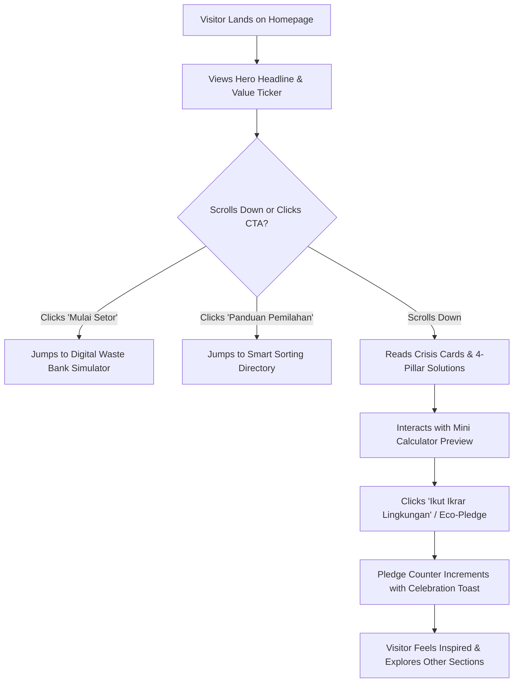
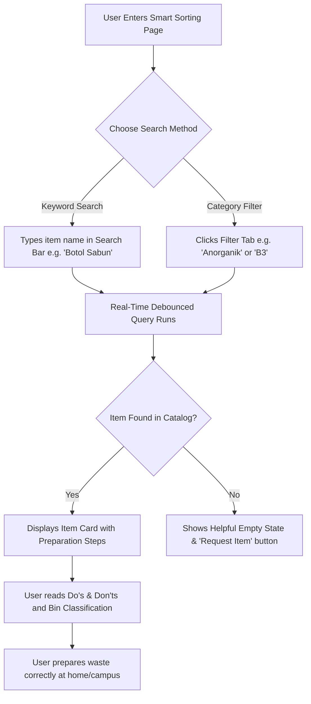
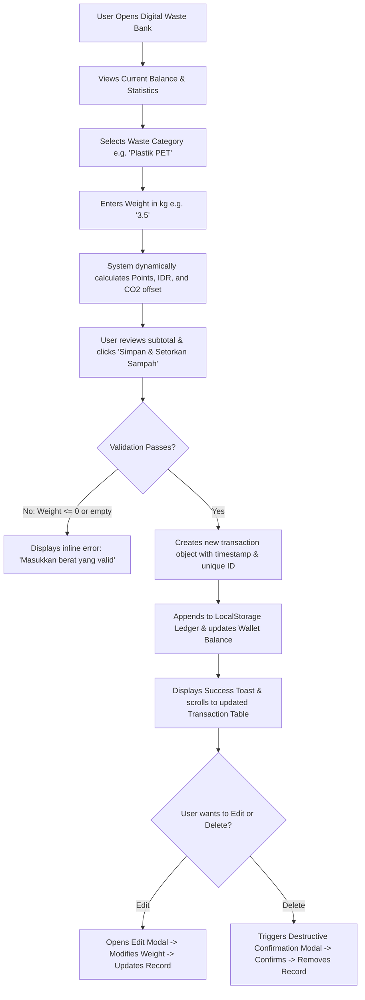
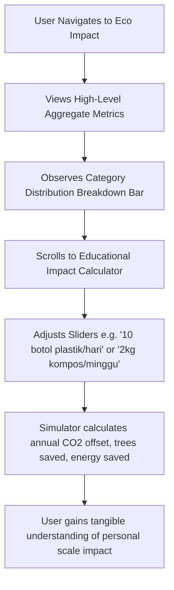
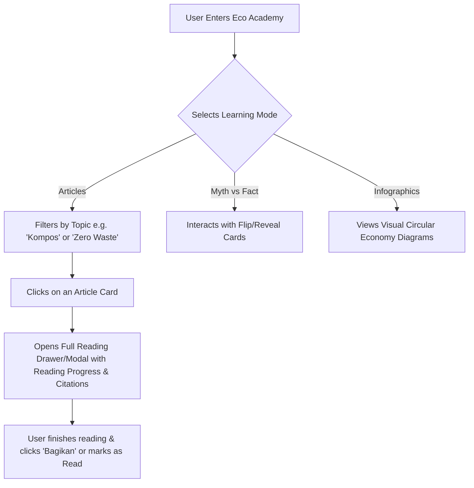
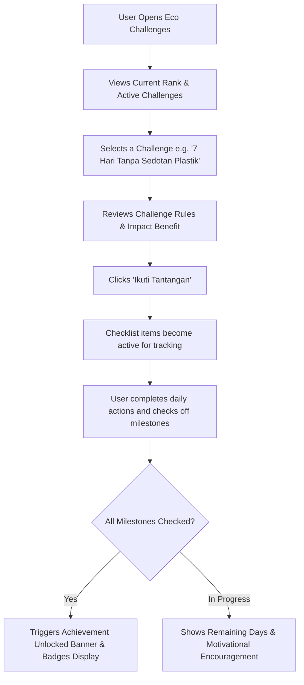

# ECOCYCLE — User Flow & Journey Maps Document

**Project:** ECOCYCLE — Turning Waste Into Worth  
**Role:** Senior UX Architect  
**Methodology:** Task-Based Interaction Flow Modeling  
**Document Status:** Approved Interaction Architecture  

---

## 1. User Journey Architecture Overview

ECOCYCLE's user flows are mapped using deterministic decision states, visual transitions, confirmation toasts, and graceful error handling. Each flow is designed to minimize cognitive friction, eliminate dead ends, and deliver clear behavioral feedback.

```
┌────────────────────────────────────────────────────────┐
│                   ECOCYCLE USER JOURNEYS               │
├────────────────────────────────────────────────────────┤
│ Flow A: First-Time Visitor Discovery                   │
│ Flow B: Search & Classify Waste Item (Smart Sorting)   │
│ Flow C: Record & Manage Recyclable Waste (Waste Bank)  │
│ Flow D: Analyze Ecological Metrics (Eco Impact)        │
│ Flow E: Consume Environmental Education (Eco Academy)  │
│ Flow F: Participate & Complete Eco Challenge           │
└────────────────────────────────────────────────────────┘
```

---

## 2. Detailed User Flow Specifications

### Flow A: First-Time Visitor Discovery Journey

*Objective: Guide a new visitor from first impression to understanding the platform's core proposition and taking an initial low-friction micro-action.*



- **Step A.1 (First Impression):** Visitor arrives on `/`. Observes high-contrast botanical styling, clear typography, and animated live commodity ticker (showing current rates for PET, Kardus, etc.).
- **Step A.2 (Scanning Solutions):** Visitor scrolls through the 3 Environmental Crisis cards and discovers how ECOCYCLE directly tackles them via the 4 Pillars.
- **Step A.3 (Interactive Hook):** Visitor tests the interactive mini-calculator on the homepage, immediately seeing how 5 kg of plastic converts into 225 EcoPoints and 7.5 kg of avoided $CO_2$.
- **Step A.4 (Commitment Action):** Visitor signs the digital Eco-Pledge, triggering an instant confetti/toast animation. This converts a passive reader into an engaged participant.

---

### Flow B: Searching for Waste Sorting Information (Smart Sorting)

*Objective: Empower a user holding a physical waste item at home or campus to find the correct bin, preparation instructions, and recyclability score within 10 seconds.*



- **Step B.1 (Entry):** User clicks "Smart Sorting" in the top navigation.
- **Step B.2 (Search Input):** User types "Botol sampo" or "Kulit pisang" in the search box.
- **Step B.3 (Instant Response):** The catalog filters in real-time ($<50\text{ms}$).
- **Step B.4 (Actionable Detail):**
  - Item: *Botol Sampo (HDPE #2)*
  - Bin: *🔵 Anorganik / Daur Ulang*
  - Preparation Steps: *1. Habiskan sisa sampo -> 2. Bilas dengan air -> 3. Lepaskan pompa/tutup jika beda bahan -> 4. Masukkan ke wadah pilah kering.*
  - Recyclability Level: *Tinggi (Bernilai ekonomis di Bank Sampah)*.
- **Step B.5 (Error / No Results):** If the search query yields 0 results, an empty state illustrates: *"Jenis sampah belum ditemukan. Coba kata kunci umum seperti 'plastik', 'kertas', atau 'baterai'."*

---

### Flow C: Recording & Managing Recyclable Waste (Digital Waste Bank)

*Objective: Enable a resident, student, or waste bank operator to calculate value, log a waste deposit, view the updated ledger, and edit or delete records.*



- **Step C.1 (Configuration):** User selects a category (e.g. *Kardus & Kertas*) from the visual dropdown.
- **Step C.2 (Input):** User inputs weight (e.g., `4.2` kg).
- **Step C.3 (Live Computation):** The form dynamically displays:
  - Estimated Value: $4.2 \times \text{Rp } 2.200 = \text{Rp } 9.240$
  - EcoPoints: $4.2 \times 22 = 92\text{ Poin}$
  - $CO_2$ Avoided: $4.2 \times 1.1 = 4.62\text{ kg } CO_2$
- **Step C.4 (Persistence & Feedback):** Clicking "Simpan & Setorkan" adds the item into the transaction history table and updates the global wallet balance. A green toast confirms: *"Setoran berhasil dicatat! +92 EcoPoints ditambahkan."*
- **Step C.5 (Record Modification):**
  - **Edit:** If the user made a typo, clicking the "Edit" pencil opens an inline modal allowing weight or category updates.
  - **Delete:** Clicking the trash icon opens a confirmation dialog: *"Apakah Anda yakin ingin menghapus catatan ini? Saldo poin akan disesuaikan kembali."*

---

### Flow D: Viewing & Simulating Environmental Impact (Eco Impact)

*Objective: Allow users to visualize collective ecological achievements and test future scenarios via the interactive calculator.*



- **Step D.1 (Dashboard Scan):** User reviews total kilograms diverted from landfills, kilograms of $CO_2$ greenhouse gas avoided, and equivalent mature trees planted.
- **Step D.2 (Visual Breakdown):** User interacts with the category breakdown bar to see which waste type contributes most to their environmental savings.
- **Step D.3 (Scenario Simulator):** User drags a slider to simulate: *"Jika seluruh anggota keluarga saya (4 orang) memilah sampah plastik selama 1 tahun..."* The calculator updates dynamically with real equivalencies (e.g., *"Setara dengan mematikan lampu LED selama 4.200 jam"*).

---

### Flow E: Reading Environmental Education Content (Eco Academy)

*Objective: Provide an educational browsing experience with articles, myth-busters, and infographics.*



- **Step E.1 (Discovery):** User browses categorized cards with estimated reading times (e.g. `⏱️ 4 menit baca`).
- **Step E.2 (Interactive Deep-Dive):** User clicks on an article to open the reading view with clear headings, callout quotes, and step-by-step action points.
- **Step E.3 (Myth Busting):** User clicks on a Myth Card (e.g., *"Semua kantong biodegradable aman dibuang sembarangan?"*). The card flips to reveal the verified scientific fact: *"Hanya dapat terurai optimal dalam kondisi komposter industri bersuhu tinggi, bukan di alam liar."*

---

### Flow F: Participating in Environmental Challenges (Eco Challenges)

*Objective: Incentivize habit formation through measurable micro-challenges and digital achievement badges.*



- **Step F.1 (Selection):** User browses available challenges categorized by difficulty (*Mudah*, *Sedang*, *Komprehensif*).
- **Step F.2 (Engagement):** User activates a challenge. The UI shifts to active tracking mode with a progress bar ($0\% \rightarrow 100\%$).
- **Step F.3 (Completion & Reward):** Upon checking all criteria, an animated celebration modal awards the corresponding digital badge (e.g., *Lencana "Pahlawan Sedotan Nihil"*), updating the user's eco-profile.
